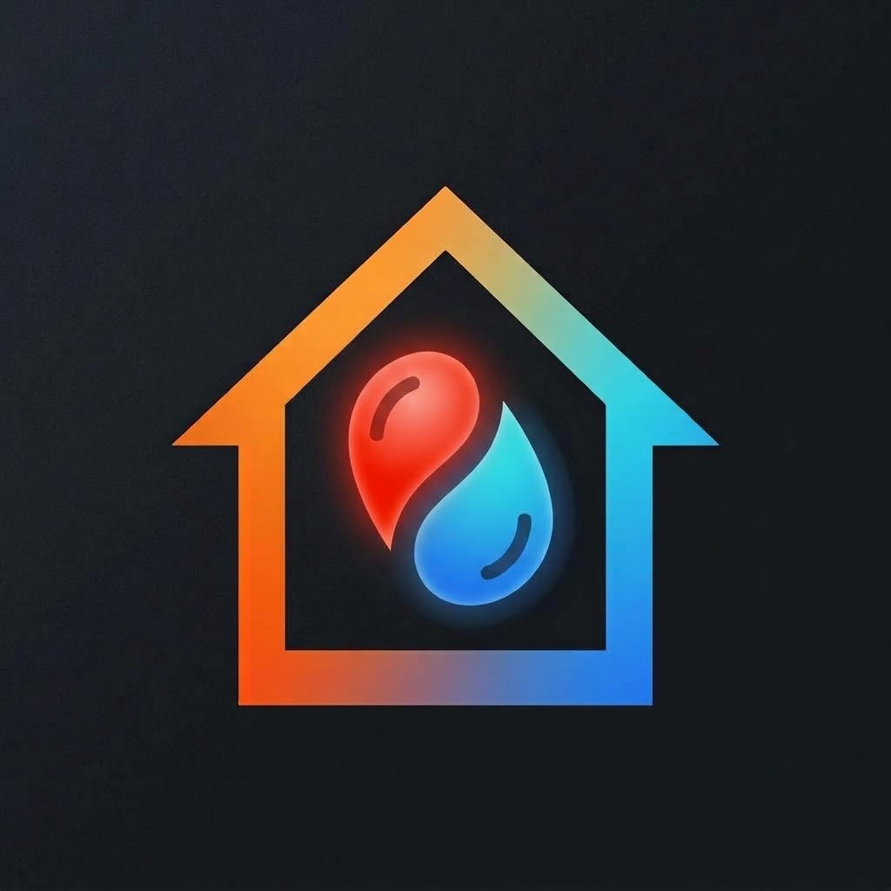

  

# TermoAlert București (CMTEB) — Home Assistant Integration

Integrare Home Assistant pentru monitorizarea în timp real a avariilor și întreruperilor de furnizare a apei calde și încălzirii din municipiul București, folosind datele oficiale publicate de **Compania Municipală Termoenergetica București (CMTEB)**.

> ☕ **Free to use, but not free to maintain. Sponsorship helps keep the project healthy and growing:**  
> 
> 

  
  &nbsp;
  
  &nbsp;
  

Direct links / Link-uri directe: [buymeacoffee.com/ygreq](https://www.buymeacoffee.com/ygreq) | [paypal.me/ygreqro](https://paypal.me/ygreqro) | [revolut.me/ygreqro](https://revolut.me/ygreqro)

